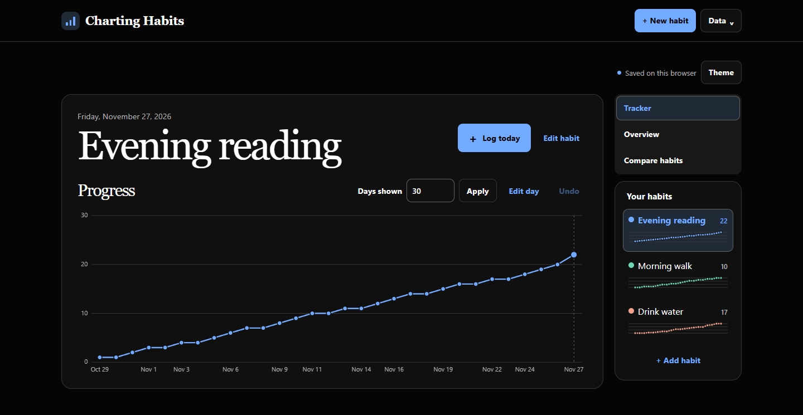

# Charting Habits

Charting Habits is an offline habit tracker you can run from a single HTML file. Log a completion with one click. The chart rises when you make progress and stays flat on days you skip.

[Download the app](https://github.com/PearceMullins/charting-habits/releases/latest/download/Charting-Habits.html) · [View the latest release](https://github.com/PearceMullins/charting-habits/releases/latest)

## Get started

1. Download the HTML file and open it in a modern browser. No account, server, or installation is needed.
2. Select **New habit**, enter a name, and choose a chart color.
3. Select **Log today** to record a completion. Every click adds one. Select a chart dot or use **Edit day** to add or remove a completion for a specific date. **Undo** reverses the last log change.
4. To remove a habit, open **Edit habit**, select **Delete habit**, and confirm. This removes that habit's completion history. Other habits keep their history.

## What you can do

- **See progress.** Each chart shows a connected line with dots. Set **Days shown** on Tracker to see more or less history. Long ranges can group days into dots. Use **Edit day** to choose an exact date.
- **Switch habits.** Select a habit in the right column to open its tracker. Its mini chart shows completions for the same date range as Overview and Compare habits.
- **View habits together.** Use the tabs above the habit list to open **Overview** or **Compare habits**. Those views and the mini charts share a **Days shown** setting separate from Tracker.
- **Choose your colors.** The default theme is black and blue. Use **Theme** to change the background and accent, and set each habit's chart color in **Edit habit**. Use the color pickers or paste a hex code.
- **Share a chart.** Open **Data → Export chart** from Tracker to save a 30-day PNG for the current habit.

## Saving and backups

The app saves habits, history, and settings in the browser when it supports storage for local files. It makes no network requests. Moving or renaming the HTML file, changing browsers, or clearing browser data can make the history unavailable in that copy.

- **Back up:** Select **Data → Export backup** to download a JSON file with your habits, history, and settings.
- **Move or restore:** Open the HTML file in the new location or browser. Select **Data → Restore backup** and choose your JSON file. The app asks before replacing existing data.
- **Start fresh:** Export any history you want to keep, then clear the browser's saved site data for the file. Removing the HTML file alone may leave saved history in the browser.

If the app shows that automatic saving is unavailable, export a backup before closing it.

## Source

[Charting Habits.html](Charting%20Habits.html) contains the interface, charts, and storage logic. To work on the app, edit the file and reload it in your browser. No build step is required.
